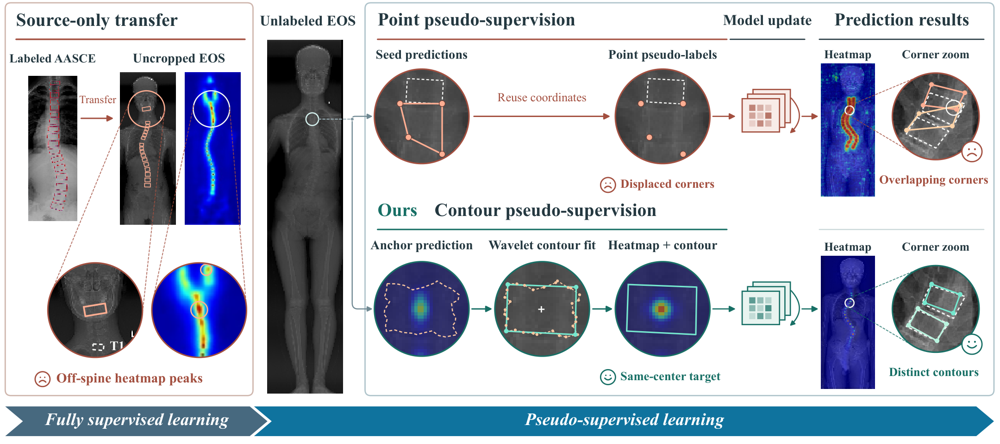
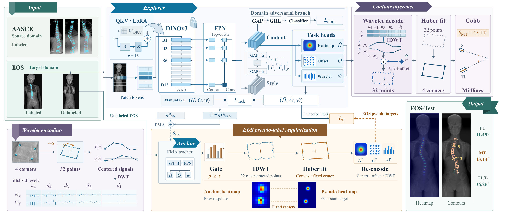

# Few-Shot Semi-Supervised Wavelet Adaptation for Automated Cobb Angle Measurement on Uncropped Full-Body Radiographs

F-SWAN adapts a vertebral contour model from conventional radiographs to uncropped full-body EOS radiographs. It uses a DINOv3 ViT-B encoder with low-rank adaptation and represents each vertebral boundary with a multiscale wavelet descriptor. During semi-supervised training, the Explorer–Anchor framework fits quadrilaterals to predicted contours and encodes the fitted boundaries as wavelet pseudo-targets for unlabeled images.

*Figure 1. Comparison of point and wavelet contour pseudo-supervision on full-body EOS radiographs.*

*Figure 2. Overall framework of F-SWAN for Cobb angle estimation on full-body EOS radiographs.*

On the held-out EOS test set, training with 10 labeled and 70 unlabeled target images yields a circular mean absolute error of **3.13 ± 0.30°** and a mean radial error of **4.23 ± 0.53 px** across five runs. With all 80 target training images labeled, the corresponding mean angular error is **3.01°**. These are the results reported in the revised manuscript.

## Single-image inference

Use Python 3.11 or later. Install PyTorch for your device, then install the inference dependencies and the official DINOv3 implementation in the same Python environment.

~~~sh
python -m pip install -r requirements.txt
python -m pip install --no-deps "git+https://github.com/facebookresearch/dinov3.git@6876159a11b4df116f30f667f8c9888617df0751"
~~~

Download the [F-SWAN inference checkpoint (28 MiB)](https://github.com/w-haodong/F_SWAN/releases/download/inference-v1/fswan-vitb-lora-eos-10l-70u.pth), trained with 10 labeled and 70 unlabeled EOS images. Obtain the matching backbone file, `dinov3_vitb16_pretrain_lvd1689m-73cec8be.pth`, from the [official DINOv3 repository](https://github.com/facebookresearch/dinov3#pretrained-models). The loader checks the backbone's SHA-256 before combining it with the released F-SWAN parameters.

Run inference on an uncropped frontal radiograph in PNG or JPEG format.

~~~sh
python infer.py \
  --image radiograph.png \
  --checkpoint /path/to/fswan-vitb-lora-eos-10l-70u.pth \
  --dino-checkpoint /path/to/dinov3_vitb16_pretrain_lvd1689m-73cec8be.pth \
  --device auto \
  --output prediction.json
~~~

The inference pipeline resizes and pads the image to 1280 × 512 pixels, reconstructs wavelet contours, and fits vertebral corners jointly with Huber regression. The JSON output contains the proximal thoracic, main thoracic, and thoracolumbar/lumbar Cobb angles in degrees and the predicted corners in the original image coordinate system. Use `--device cpu` or `--device cuda:0` to select a device explicitly.

## Data

[AASCE 2019](https://aasce19.grand-challenge.org/) provides the public source-domain radiographs. Access to the clinical EOS cohort is governed by the hospital's data access policy.

## Acknowledgments

We thank Meta AI for releasing [DINOv3](https://github.com/facebookresearch/dinov3).
